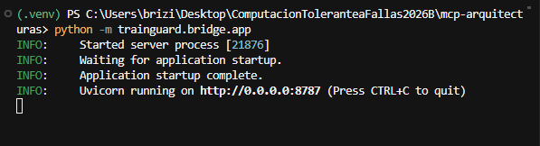
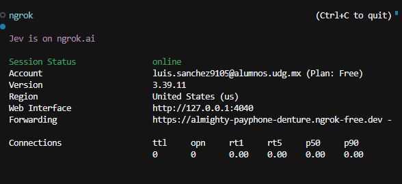
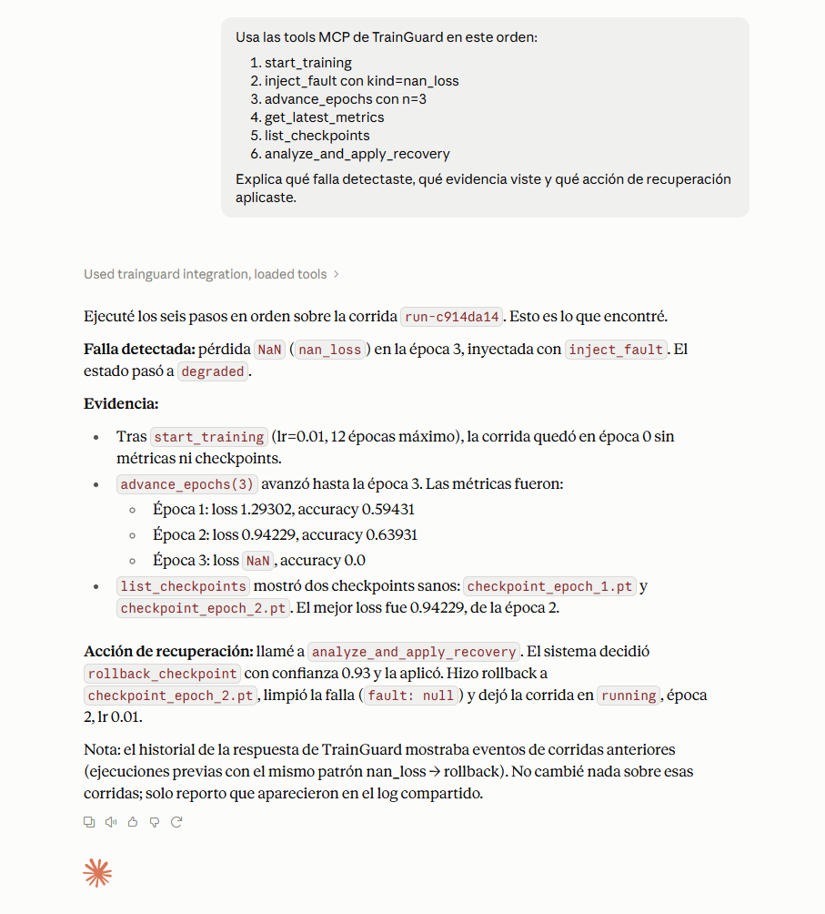
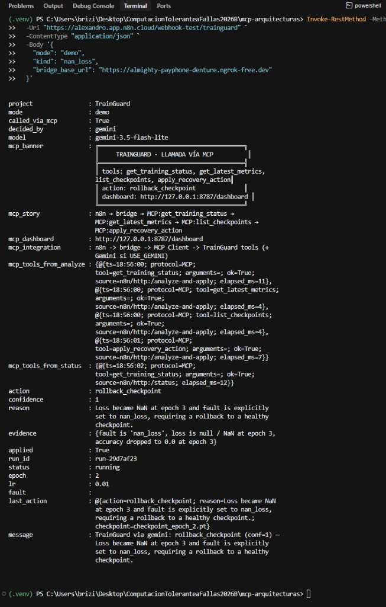

# Práctica: TrainGuard (n8n + MCP + Gemini)

Implementé **TrainGuard**: un sistema que simula el entrenamiento de una red neuronal, inyecta fallas típicas (loss NaN, LR explosivo, estancamiento) y aplica **recuperación automática** (rollback a checkpoint, bajar LR, alertar).

La idea une tres piezas:

- **MCP (Model Context Protocol)** — servidor de tools que se ejecutan .
- **n8n** — workflow que orquesta el escenario por webhook y llama esas tools vía un bridge HTTP.
- **Gemini** (`gemini-3.5-flash-lite`) — LLM que, en el camino de n8n, **llama tools MCP** (function calling): lee métricas/checkpoints y aplica la recuperación.

Así se demuestra tolerancia a fallas en un pipeline de ML: detectar la falla, decidir con evidencia (LLM o heurística) y recuperar el run.

---


## ¿Qué es MCP?

**MCP** es un protocolo para que un modelo use **herramientas y contexto reales**. No es un prompt: el prompt *indica* qué hacer; MCP *expone funciones ejecutables* (`start_training`, `inject_fault`, `apply_recovery_action`, etc.).

En este proyecto el servidor MCP es `trainguard/mcp_server.py` (entrada para Claude Desktop: `run_mcp.py`).


| Concepto    | En TrainGuard                                              |
| ----------- | ---------------------------------------------------------- |
| MCP server  | Caja de tools (`mcp_server.py`)                            |
| Tool        | Acción real (inyectar falla, listar checkpoints, rollback) |
| Cliente MCP | Claude Desktop, Gemini (function calling) o el bridge      |
| Gemini      | Cliente MCP vía function calling (decide y aplica)         |
| n8n         | Orquesta el flujo y dispara el bridge                      |


---


## Propuesta del escenario


### El problema

Un entrenamiento puede “seguir corriendo” pero estar roto: loss en NaN, learning rate demasiado alto, o métricas estancadas. Sin un watchdog, se pierde tiempo y a veces el mejor checkpoint.

### Por qué n8n + MCP + Gemini

- **MCP** define las capacidades del agente (tools estables, reutilizables).
- **n8n** automatiza: webhook → start → inject fault → analyze/apply → respuesta.
- **Gemini** es cliente MCP: pide tools, lee evidencia y llama `apply_recovery_action`.
- **Claude Desktop** usa las *mismas* tools a mano, para demostrar el servidor MCP sin n8n.


### Qué tipo de falla se simula


| Falla (`kind`) | Síntoma                | Acción típica          |
| -------------- | ---------------------- | ---------------------- |
| `nan_loss`     | loss = NaN, accuracy 0 | `rollback_checkpoint`  |
| `exploding_lr` | LR alto / loss dispara | `reduce_lr_and_resume` |
| `stall`        | loss casi no baja      | reducir LR o alertar   |


### Qué estrategia de tolerancia se aplica

1. **Checkpointing** — se guardan checkpoints sanos por época.
2. **Detección** — Gemini (o el bridge) lee métricas recientes con tools MCP.
3. **Decisión** — Gemini elige una acción con `confidence` (si no hay API key, heurística local).
4. **Recuperación** — Gemini llama `apply_recovery_action` vía MCP cuando confía; si no, `alert_only`.
5. **Trazabilidad** — evidencia + feed en el dashboard MCP.

---


## Cómo está armado

```text
Claude Desktop ──(MCP stdio)──► mcp_server.py ──► engine.py
                                                      ▲
n8n ──HTTP──► ngrok ──► bridge ──(MCP Client)─────────┘
                         │
                         ├── Gemini (function calling) pide tools MCP
                         ├── MCP: get_training_status / metrics / checkpoints
                         ├── MCP: apply_recovery_action (si confía)
                         └── /dashboard (feed visual)
```


| Pieza                              | Rol                                                  |
| ---------------------------------- | ---------------------------------------------------- |
| `trainguard/engine.py`             | Simulación de entrenamiento, fallas y recuperación   |
| `trainguard/mcp_server.py`         | Servidor MCP (tools)                                 |
| `run_mcp.py`                       | Entrada limpia para Claude Desktop                   |
| `trainguard/bridge/app.py`         | Bridge HTTP: n8n → MCP (+ agente Gemini)             |
| `trainguard/llm_gemini.py`         | Gemini con function calling sobre tools MCP          |
| `trainguard/bridge/dashboard.html` | Monitor en vivo de llamadas MCP                      |
| `n8n/trainguard-workflow.json`     | Workflow importable en n8n                           |
| `.env`                             | `GEMINI_*` / `USE_GEMINI` / `GEMINI_MCP_AGENT`       |
| `runs/current_run.json`            | Estado del run actual                                |


n8n Cloud no habla MCP stdio; el **bridge** traduce HTTP a **llamadas MCP**. Con `USE_GEMINI=true` y `GEMINI_MCP_AGENT=true` (default), **Gemini elige y ejecuta tools MCP** (como Claude Desktop). Sin key, cae a heurística local. Con `GEMINI_MCP_AGENT=false` queda el modo legacy (Gemini solo JSON; el bridge aplica).

---


## Cómo ejecutarlo


### 1. Dependencias

```powershell
cd n8nmcp
.\.venv\Scripts\Activate.ps1
pip install -r requirements.txt
```


### 2. Gemini (LLM en el camino n8n)

```powershell
copy .env.example .env
# Edita .env: GEMINI_API_KEY=...  GEMINI_MODEL=gemini-3.5-flash-lite
#             USE_GEMINI=true  GEMINI_MCP_AGENT=true
```

Flujo de `/analyze-and-apply` con Gemini + MCP (function calling):

1. El bridge expone a Gemini las tools MCP (schemas)
2. **Gemini** llama MCP: lee `get_training_status` / `get_latest_metrics` / `list_checkpoints`
3. **Gemini** decide y llama MCP `apply_recovery_action` (si `confidence` alta)
4. Responde JSON (`decided_by: gemini_mcp`, `llm_uses_mcp: true`)

> No pegues la API key en chats ni en el README. Si se filtró, revócala y genera otra.


### 3. Bridge + ngrok

Terminal 1 — bridge:

```powershell
python -m trainguard.bridge.app
```



Terminal 2 — túnel público para n8n Cloud:

```powershell
ngrok http 8787
```



Dashboard: [http://127.0.0.1:8787/dashboard](http://127.0.0.1:8787/dashboard)

### 4. Claude Desktop (MCP directo)

Copia el bloque `mcpServers.trainguard` de `claude_desktop_config.json` a la config real de Claude y reinicia. En un chat nuevo:

```text
Usa las tools MCP de TrainGuard en este orden:
1) start_training
2) inject_fault con kind=nan_loss
3) advance_epochs con n=3
4) get_latest_metrics
5) list_checkpoints
6) analyze_and_apply_recovery

Explica qué falla detectaste, qué evidencia viste y qué acción de recuperación aplicaste.
```


### 5. n8n

1. Importa `n8n/trainguard-workflow.json`.
2. **Listen for test event** (o publica y usa la URL Production).
3. Dispara el webhook con tu URL de ngrok:

```powershell
Invoke-RestMethod -Method Post `
  -Uri "https://TU-INSTANCIA.app.n8n.cloud/webhook-test/trainguard" `
  -ContentType "application/json" `
  -Body '{
    "mode": "demo",
    "kind": "nan_loss",
    "bridge_base_url": "https://TU-URL.ngrok-free.dev"
  }'
```

`mode`: `demo` | `analyze` | `inject`  
`kind`: `nan_loss` | `exploding_lr` | `stall`

---


## Nodos del workflow n8n (qué hace cada uno)


| Nodo                   | Tipo           | Qué hace                                                                                                            |
| ---------------------- | -------------- | ------------------------------------------------------------------------------------------------------------------- |
| **Webhook TrainGuard** | Webhook (POST) | Entrada del flujo. Recibe JSON (`mode`, `kind`, `bridge_base_url`).                                                 |
| **Normalize Input**    | Code           | Limpia el body, pone defaults (`mode=demo`, `kind=nan_loss`) y normaliza la URL del bridge.                         |
| **Route by Mode**      | Switch         | Bifurca según `mode`: `demo`, `analyze`, `inject` o fallback.                                                       |
| **Start Training**     | HTTP Request   | `POST {bridge}/start` → el bridge llama la tool MCP `start_training`. Solo en path `demo`.                          |
| **Inject Fault**       | HTTP Request   | `POST {bridge}/inject-fault` → MCP `inject_fault` + `advance_epochs` (aparecen métricas con la falla). Path `demo`. |
| **Inject Fault Only**  | HTTP Request   | Igual que inject, pero sin pasar por start (path `inject`).                                                         |
| **Analyze and Apply**  | HTTP Request   | `POST {bridge}/analyze-and-apply` → **Gemini llama tools MCP** (lee + aplica recovery).                             |
| **Get Status**         | HTTP Request   | `GET {bridge}/status` → tool MCP `get_training_status` para confirmar el estado final.                              |
| **Build Summary**      | Code           | Arma la respuesta: `decided_by`, `model`, tools MCP usadas, acción, evidencia, banner.                              |
| **Respond to Webhook** | Respond        | Devuelve el JSON resumen al cliente que llamó el webhook.                                                           |


Path típico de la demo (`mode=demo`):

`Webhook → Normalize → Route(demo) → Start Training → Inject Fault → Analyze and Apply → Get Status → Build Summary → Respond`

---


## Demostración


### Camino A — Claude Desktop + MCP

Claude carga la integración `trainguard`, ejecuta las tools y reporta NaN en la época 3, checkpoints sanos y recuperación `rollback_checkpoint`, dejando el run en `running`.



### Camino B — n8n + MCP + Gemini

El webhook dispara el workflow; Gemini (`gemini-3.5-flash-lite`) actúa como cliente MCP (function calling). En la respuesta se ve:

- `decided_by: gemini_mcp`
- `llm_uses_mcp: True`
- `model: gemini-3.5-flash-lite`
- `called_via_mcp: True`
- `gemini_requested_mcp_tools: [...]` (tools que el LLM pidió)
- `mcp_story: n8n → bridge → MCP:get_training_status → … → MCP:apply_recovery_action`
- `action: rollback_checkpoint`, `applied: True`



### Monitor visual de tools MCP

El dashboard muestra en vivo cada tool MCP invocada desde n8n (`start_training`, `inject_fault`, `get_latest_metrics`, `apply_recovery_action`, …).


---


## Tools MCP expuestas


| Tool                         | Qué hace                                         |
| ---------------------------- | ------------------------------------------------ |
| `start_training`             | Inicia un run simulado                           |
| `advance_epochs`             | Avanza N épocas y registra métricas              |
| `get_training_status`        | Estado completo del run                          |
| `get_latest_metrics`         | Últimas métricas                                 |
| `list_checkpoints`           | Checkpoints y mejor loss                         |
| `inject_fault`               | Inyecta `nan_loss` / `exploding_lr` / `stall`    |
| `analyze_training`           | Recomienda acción (heurística JSON)              |
| `apply_recovery_action`      | Aplica una acción concreta                       |
| `analyze_and_apply_recovery` | Analiza y aplica (heurística; Claude / fallback) |


---


## Archivos


| Archivo / carpeta              | Rol                                          |
| ------------------------------ | -------------------------------------------- |
| `trainguard/`                  | Engine, MCP server, bridge y cliente Gemini  |
| `run_mcp.py`                   | Entrypoint MCP para Claude                   |
| `n8n/trainguard-workflow.json` | Workflow n8n                                 |
| `claude_desktop_config.json`   | Ejemplo de config MCP                        |
| `.env.example`                 | Plantilla de variables Gemini                |
| `requirements.txt`             | Dependencias Python                          |
| `Imagenes/`                    | Capturas de la demo                          |
| `runs/`                        | Estado persistido del entrenamiento simulado |


| Captura                           | Contenido                          |
| --------------------------------- | ---------------------------------- |
| `Imagenes/bridge_uvicorn.png`     | Bridge escuchando en `:8787`       |
| `Imagenes/ngrok_tunnel.png`       | Túnel ngrok al bridge              |
| `Imagenes/n8n_workflow.png`       | Workflow n8n ejecutado OK          |
| `Imagenes/consola_n8n_gemini.png` | Respuesta con `decided_by: gemini_mcp` |
| `Imagenes/dashboard_mcp.png`      | Feed visual de tools MCP           |
| `Imagenes/claude_mcp_tools.png`   | Claude Desktop usando MCP          |


---


## Posibles mejoras a futuro


### Entrenamiento más real

- Sustituir la simulación de `engine.py` por un entrenamiento real (PyTorch/TensorFlow) con MNIST/CIFAR pequeño.
- Guardar checkpoints `.pt` / `.ckpt` de verdad y validar integridad (checksum) antes del rollback.
- Integrar métricas de W&B, MLflow o TensorBoard en lugar del JSON local.


### Más fallas y políticas

- Nuevas fallas: OOM de GPU, proceso colgado, dataset corrupto, drift de clases.
- Réplicas con distinta seed y “consenso” (descartar el run anómalo).
- Modo degradado: si no hay checkpoint sano, entrenar con batch más chico / modelo más ligero.
- Human-in-the-loop: si `confidence < umbral`, n8n pide aprobación en Slack/Discord antes de aplicar.


### MCP / agente

- Probar `GEMINI_MODEL=gemini-3.8-flash` u otros modelos.
- Resources MCP (no solo tools): exponer `metrics://latest` o el runbook como recurso.
- Auth y scopes en tools peligrosas (`stop_training`, `inject_fault`).
- Dejar que Gemini también elija el `mode` del workflow n8n (no solo analyze).


### n8n / automatización

- Cron periódico que solo haga `analyze`, sin demos manuales.
- Notificaciones (Slack/Discord/Email) con el `mcp_story` y link al dashboard.
- Webhook de GitHub/CI: si fallan tests del trainer, disparar TrainGuard.
- Cola de reintentos si el bridge o ngrok caen.


### Observabilidad y UI

- Persistir el feed MCP y graficar historial de recuperaciones.
- Dashboard con curva loss/accuracy en vivo y marca del rollback.
- Informe de incidente PDF/Markdown por run.
- Multi-run en el dashboard.


### Despliegue / académico

- Docker Compose para bridge + MCP; túnel estable (Cloudflare) en lugar de ngrok free.
- Comparar con checkpointing clásico midiendo tiempo perdido con/sin recuperación.
- Tabla falla inyectada vs acción vs éxito (cobertura).

---


## Conclusión

TrainGuard muestra tolerancia a fallas en entrenamiento: se inyecta una falla, se recoge evidencia y se recupera (rollback / LR). **MCP** estandariza las tools; **Claude** y **Gemini** las usan como clientes (stdio vs function calling en el bridge); **n8n** orquesta el flujo. El dashboard hace visible que las tools las pide el LLM o el bridge, siempre por MCP.