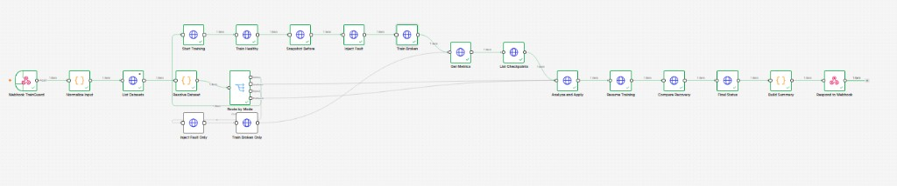
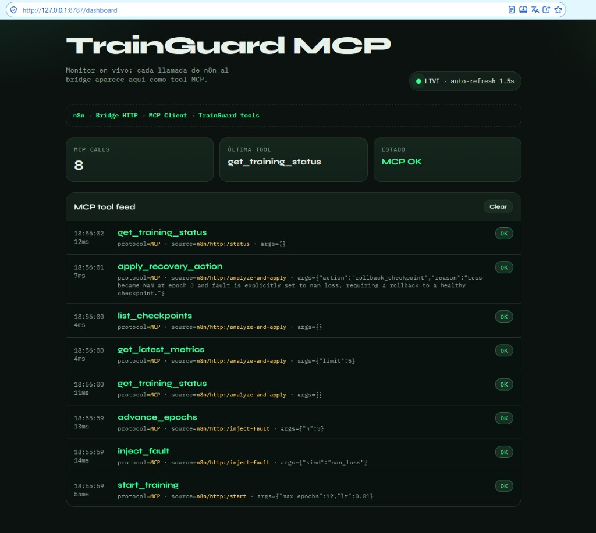

https://github.com/user-attachments/assets/26cefc80-0cea-4450-8c63-7a8b3398ab68

# Práctica: TrainGuard (n8n + MCP + Gemini)

**TrainGuard** entrena un CNN pequeño (PyTorch, CPU) sobre **MNIST, Fashion-MNIST, CIFAR-10 o un dataset propio**, provoca fallas controladas pero reales (loss NaN, learning rate explosivo, estancamiento), guarda checkpoints `.pt` y recupera el run (rollback a `best.pt` o bajar el LR). Al final mide si se conservó el mejor resultado y si el entrenamiento pudo continuar.

Tres piezas:

- **n8n** — orquesta el experimento. El webhook (o el botón **Iniciar** del dashboard) dispara el flujo: elegir dataset, entrenar, fallar, recuperar y comparar.
- **MCP** — tools ejecutables (`start_training`, `advance_epochs`, `inject_fault`, `apply_recovery_action`, `compare_recovery`, …). n8n no habla MCP stdio; un bridge HTTP traduce cada nodo a una tool.
- **Gemini** (`gemini-3.5-flash-lite`) — dentro de **Analyze and Apply**, lee métricas y checkpoints por function calling y aplica la recuperación. Sin API key, cae a una heurística local.

---


## ¿Qué es MCP?

MCP expone funciones reales. El prompt indica qué hacer; la tool lo ejecuta.


| Concepto   | En TrainGuard                                            |
| ---------- | -------------------------------------------------------- |
| MCP server | `trainguard/mcp_server.py`                               |
| Tool       | Acción real (entrenar una época, listar `.pt`, rollback) |
| Cliente    | El bridge (n8n → HTTP) y Gemini (function calling)       |
| n8n        | Orquesta el orden de las llamadas                        |
| Dashboard  | Dispara el webhook y muestra el proceso en vivo          |


n8n Cloud no habla MCP stdio. El bridge (`python -m trainguard.bridge.app`, puerto 8787) recibe HTTP y llama las tools. Con `USE_GEMINI=true` y `GEMINI_MCP_AGENT=true` (default), Gemini elige y ejecuta las tools de lectura y `apply_recovery_action`. Sin key, decide la heurística. Con `GEMINI_MCP_AGENT=false`, Gemini solo devuelve JSON y el bridge aplica la acción.

## Por qué n8n y MCP juntos

Cada uno resuelve una mitad distinta del problema. Juntos arman el experimento.


|                       | n8n                                                                | MCP                                                                         |
| --------------------- | ------------------------------------------------------------------ | --------------------------------------------------------------------------- |
| Pregunta que responde | ¿Cuándo y en qué orden?                                            | ¿Qué se puede hacer de verdad?                                              |
| En la demo            | Webhook, dataset, falla, épocas sanas, época rota, resume, compare | `start_training`, `advance_epochs`, `inject_fault`, `apply_recovery_action` |
| Lo que no hace        | No entrena ni carga un `.pt`                                       | No decide el guion ni se dispara solo                                       |


n8n solo, con nodos HTTP, podría pegarle a una API, pero cada cambio de trainer obligaría a reescribir URLs y cuerpos. MCP solo deja las tools listas, pero alguien tiene que llamarlas a mano y en orden. La combinación es esta:

1. **n8n es el orquestador.** El canvas es el experimento: start, entrenar, romper, leer evidencia, recuperar, medir. Cambiar el orden o el dataset es mover nodos, no tocar PyTorch.
2. **MCP es el contrato.** Las mismas tools sirven al bridge, a Gemini y a cualquier otro cliente. Entrenar una época o hacer rollback es una función con nombre, argumentos y resultado, no un script suelto.
3. **El bridge es el adaptador.** n8n Cloud habla HTTP; el servidor MCP habla tools. Cada nodo HTTP Request es una tool. Por eso en el dashboard cada fila dice `n8n · Inject Fault → MCP · inject_fault`.
4. **Gemini es un cliente MCP dentro de un nodo.** En **Analyze and Apply** no inventa el loss: pide `get_latest_metrics` y `list_checkpoints`, y si confía llama `apply_recovery_action`. n8n no elige el rollback; el modelo lo elige con evidencia.


---


## El escenario

Un entrenamiento puede seguir “corriendo” y estar roto: loss en NaN, LR demasiado alto o métricas estancadas. Sin un watchdog se pierde tiempo y, a veces, el mejor checkpoint.

TrainGuard lo demuestra con un run real (TinyCNN), no con una curva inventada. El dataset no está fijo: n8n lo resuelve y MCP arranca el trainer correcto.

### Cómo funciona el entrenamiento

Cada **Iniciar** (o un webhook con `mode: demo`) abre un entrenamiento nuevo. `start_training` genera un `run_id` (`run-` y ocho caracteres), una carpeta `runs/<run_id>/` y una red con pesos nuevos. Todos los nodos de esa ejecución trabajan sobre ese mismo modelo: las épocas sanas, la falla, el rollback y el resume. El rollback carga el `best.pt` de esa carpeta y sigue; no abre otro entrenamiento.

El siguiente Iniciar no continúa el anterior. En memoria y en `runs/current_run.json` solo hay un run activo. Las carpetas viejas se quedan en `runs/`, con sus `.pt`, y el engine ya no las entrena.

La receta es la misma en todos los demos: TinyCNN en CPU, SGD con learning rate 0.01, semilla 42, unas 2 000 imágenes de train y 1 000 de validación, lote de 64 y tope de 6 épocas. La semilla hace que dos demos del mismo dataset arranquen parecido; cada uno tiene sus propios checkpoints.

Lo que cambia de un demo a otro es el dataset (MNIST, Fashion-MNIST, CIFAR-10 o una carpeta propia). TinyCNN se adapta a canales, tamaño de imagen y número de clases. Los pesos de un dataset no se reutilizan en otro.

`analyze` e `inject` no pasan por **Start Training**: actúan sobre el run que ya está en `current_run.json`.

### Fallas

La falla se **arma** a propósito (`inject_fault`). El síntoma sale del loop de PyTorch, no de un JSON inventado.


| Falla (`kind`) | Cómo se provoca                                                          | Acción típica          |
| -------------- | ------------------------------------------------------------------------ | ---------------------- |
| `nan_loss`     | El loss del batch se multiplica por NaN y los pesos dejan de ser finitos | `rollback_checkpoint`  |
| `exploding_lr` | El optimizer pasa a LR = 5.0 y sigue entrenando                          | `reduce_lr_and_resume` |
| `stall`        | LR ≈ 0 y el 90 % de las labels se aleatorizan                            | reducir LR o alertar   |


Si se pide bajar el LR y los pesos ya son NaN, el engine escala solo a rollback.

### Tolerancia

1. **Checkpoint real.** Cada época sana guarda `epoch_XXX.pt` (`state_dict`, optimizer, métricas, `sha256`). `best.pt` solo se escribe si mejora `val_acc`.
2. **Snapshot.** Antes de la falla se guarda `best_acc` y el hash de `best.pt`.
3. **Detección.** Gemini (o la heurística) lee estado, métricas y checkpoints por MCP.
4. **Recuperación.** `rollback_checkpoint` hace `torch.load(best.pt)` y **no pisa** ese archivo. `reduce_lr_and_resume` baja el LR del optimizer.
5. **Resume.** n8n pide más épocas desde los pesos recuperados.
6. **Medición.** `compare_recovery` contrasta el best de antes vs el de después:
  - `preserved_best` — `best_acc_after >= best_acc_before`
  - `resumed` + `latest_healthy` — el run sigue y la última época no es NaN
  - `recovery_success` — las dos cosas

En el dashboard, la fila de época **repetida** (por ejemplo un segundo “epoch 2” con la misma accuracy) es el rollback: no entrena, reevalúa `best.pt` y deja una métrica `restored_from_checkpoint`. Después vienen las épocas nuevas, ya sanas. Si esas superan el récord, el `sha256` de `best.pt` cambia **después** del rollback, porque el archivo se actualizó al mejorar, no porque el rollback lo haya pisado.

---


## Cómo está armado

```text
Dashboard (Iniciar) ──webhook──► n8n
                                   │
                                   ▼
                              ngrok ──► bridge :8787
                                           │
                                           ├── Gemini pide tools MCP
                                           └── MCP Client ──► engine ──► trainer (TinyCNN + .pt)
```


| Pieza                              | Rol                                                                |
| ---------------------------------- | ------------------------------------------------------------------ |
| `trainguard/datasets.py`           | Catálogo: MNIST, Fashion-MNIST, CIFAR-10, ImageFolder, ZIP por URL |
| `trainguard/trainer.py`            | TinyCNN adaptable + lectura/escritura de `.pt`                     |
| `trainguard/engine.py`             | Loop, fallas controladas, rollback y `compare_recovery`            |
| `trainguard/mcp_server.py`         | Servidor MCP (tools)                                               |
| `trainguard/bridge/app.py`         | HTTP: n8n y dashboard → MCP                                        |
| `trainguard/llm_gemini.py`         | Gemini con function calling sobre tools MCP                        |
| `trainguard/bridge/dashboard.html` | Botón Iniciar, métricas, recovery y feed MCP                       |
| `n8n/trainguard-workflow.json`     | Workflow importable                                                |
| `.env`                             | `GEMINI_*`, `N8N_WEBHOOK_URL`, `BRIDGE_PUBLIC_URL`                 |
| `runs/<run_id>/*.pt`               | `last.pt`, `best.pt`, `epoch_XXX.pt`                               |
| `data/`                            | Datasets torchvision y carpetas custom (gitignore)                 |


---


## Cómo ejecutarlo


### 1. Dependencias

```powershell
cd n8nmcp
.\.venv\Scripts\Activate.ps1
pip install -r requirements.txt
```


### 2. Variables

```powershell
copy .env.example .env
```

En `.env`:

```text
GEMINI_API_KEY=...
GEMINI_MODEL=gemini-3.5-flash-lite
USE_GEMINI=true
GEMINI_MCP_AGENT=true
N8N_WEBHOOK_URL=https://TU-INSTANCIA.app.n8n.cloud/webhook-test/trainguard
BRIDGE_PUBLIC_URL=https://TU-URL.ngrok-free.dev
```

No pegues la API key en el README ni en chats. Si se filtró, revócala.

`/analyze-and-apply` con Gemini:

1. El bridge le pasa los schemas MCP.
2. Gemini llama `get_training_status`, `get_latest_metrics` y `list_checkpoints`.
3. Si confía, llama `apply_recovery_action`.
4. La respuesta trae `decided_by: gemini_mcp`.


### 3. Bridge y túnel

Terminal 1:

```powershell
python -m trainguard.bridge.app
```

Terminal 2 (n8n Cloud tiene que alcanzar tu máquina):

```powershell
ngrok http 8787
```

`BRIDGE_PUBLIC_URL` debe ser la URL HTTPS de ngrok, sin barra final.

### 4. n8n

1. Importa `n8n/trainguard-workflow.json` (reimpórtalo si ya tenías una versión anterior).
2. **Listen for test event**, o publica el workflow y usa la URL Production en `N8N_WEBHOOK_URL`.
3. Reinicia el bridge después de cambiar `.env`.

Desde el dashboard: [http://127.0.0.1:8787/dashboard](http://127.0.0.1:8787/dashboard). Elige dataset y falla, pulsa **Iniciar**. n8n orquesta; el dashboard pinta pasos, métricas, `recovery_success` y cada tool MCP.

O desde PowerShell (el JSON va **dentro** de `-Body`; PowerShell no acepta un `{ ... }` suelto):

```powershell
Invoke-RestMethod -Method Post `
  -Uri "https://TU-INSTANCIA.app.n8n.cloud/webhook-test/trainguard" `
  -ContentType "application/json" `
  -Body '{
    "mode": "demo",
    "kind": "nan_loss",
    "dataset": "fashion_mnist",
    "bridge_base_url": "https://TU-URL.ngrok-free.dev"
  }'
```

`mode`: `demo` | `analyze` | `inject`  
`kind`: `nan_loss` | `exploding_lr` | `stall`  
`dataset`: `auto` | `mnist` | `fashion_mnist` | `cifar10` | `custom`

La primera vez, cada dataset de torchvision se descarga a `data/`. Una época en CPU tarda unos 10–40 s. Los nodos de entrenamiento tienen timeout de 180 s.

### Dataset propio

Imágenes por carpeta (ImageFolder). No hace falta cambiar el workflow:

```text
data/custom/mi_dataset/
  train/clase_a/*.jpg
  train/clase_b/*.jpg
  val/clase_a/*.jpg
  val/clase_b/*.jpg
```

Con `dataset: "auto"` n8n usa la primera carpeta de `data/custom/`. También vale `dataset: "custom"` más `dataset_path`, o un ZIP por `dataset_url` con la misma estructura. Si no hay `val/`, el trainer parte el train 80/20. El CNN se adapta a canales, tamaño y número de clases.

---


## Nodos del workflow



botón **Iniciar** siempre envía `mode: demo`. Las demás rutas utilizan el mismo webhook, pero se activan cambiando el valor de `mode` en el JSON de la solicitud, como en el ejemplo de PowerShell mostrado anteriormente.

Las tres rutas principales (`demo`, `inject` y `analyze`) comparten el tramo final del workflow:

**Analyze and Apply → Resume → Compare → Final Status → Build Summary → Respond**

El nodo **Resume** ejecuta dos épocas adicionales en todos los modos. La diferencia entre las rutas está en las operaciones que se realizan antes de llegar al análisis y la recuperación.

`demo` — experimento completo. Camino de arriba. Crea el run, entrena 2 épocas sanas, guarda el snapshot, arma la falla, entrena 1 época rota y después entra al tramo final. Es el de la captura y el del botón.

`inject` — falla sobre el run que ya existe. Camino de abajo. No llama a Start ni entrena épocas sanas: **Inject Fault Only** arma `kind` y **Train Broken Only** corre 1 época con esa falla. En **Get Metrics** se junta con `demo`. Sirve para romper un entrenamiento que ya dejaste a medias. Si `current_run.json` está idle o no hay trainer, `inject_fault` arranca un run con los defaults (MNIST, sin épocas previas) y le pone la falla encima.

`analyze` — no inyecta otra falla. Entra directo a **Analyze and Apply**: Gemini lee el run activo y aplica rollback o baja el LR si las métricas lo piden. Después sigue el tramo final, incluidas las 2 épocas de Resume, aunque la acción haya sido `alert_only`. Si el run no tiene métricas, el bridge entrena 2 épocas antes de preguntarle a Gemini, para tener algo que leer.

**Cualquier otro** `mode` — el switch no lo reconoce y usa la misma salida que `analyze`.

Camino `demo` (el del botón Iniciar):

`Webhook → Normalize → List Datasets → Resolve Dataset → Route(demo) → Start → Train Healthy → Snapshot → Inject → Train Broken → Metrics → Checkpoints → Analyze and Apply → Resume → Compare → Final Status → Build Summary → Respond`


| Nodo                   | Qué hace                                                                                     |
| ---------------------- | -------------------------------------------------------------------------------------------- |
| **Webhook TrainGuard** | Entrada POST (`mode`, `kind`, `dataset`, `bridge_base_url`, …).                              |
| **Normalize Input**    | Defaults: `mode=demo`, `kind=nan_loss`, `dataset=auto`, 2 épocas sanas, 1 rota, 2 de resume. |
| **List Datasets**      | `GET /datasets` → MCP `list_datasets`.                                                       |
| **Resolve Dataset**    | Elige URL, path, la primera carpeta `data/custom/` o MNIST.                                  |
| **Route by Mode**      | Parte en `demo`, `analyze` o `inject`. Un `mode` desconocido cae en `analyze`.               |
| **Start Training**     | `POST /start` → MCP `start_training`. Solo en `demo`.                                        |
| **Train Healthy**      | `POST /advance` con 2 épocas. Escribe `best.pt`.                                             |
| **Snapshot Before**    | `GET /status`. Guarda `best_acc` y `sha256` antes de la falla.                               |
| **Inject Fault**       | `POST /inject-fault`. Arma la falla; no entrena.                                             |
| **Train Broken**       | `POST /advance` con 1 época rota (la fila NaN).                                              |
| **Inject Fault Only**  | Igual que Inject, path `inject`, sin Start.                                                  |
| **Train Broken Only**  | La época rota de ese path.                                                                   |
| **Get Metrics**        | `GET /metrics` → MCP `get_latest_metrics`.                                                   |
| **List Checkpoints**   | `GET /checkpoints` → paths y `sha256`.                                                       |
| **Analyze and Apply**  | Gemini llama tools MCP y aplica rollback o baja el LR.                                       |
| **Resume Training**    | 2 épocas desde los pesos recuperados.                                                        |
| **Compare Recovery**   | `GET /compare` → `preserved_best`, `recovery_success`.                                       |
| **Final Status**       | Estado final del run.                                                                        |
| **Build Summary**      | JSON de respuesta: dataset, acción, evidencia, best antes/después.                           |
| **Respond to Webhook** | Devuelve ese JSON al dashboard o a PowerShell.                                               |


---


## Qué se ve en el dashboard

Demo completa: el botón **Iniciar** dispara n8n y el dashboard muestra las tools MCP, la falla y la recuperación.



Arriba quedan tres papeles fijos: **n8n** orquesta, el **bridge** traduce HTTP a MCP, y **MCP** entrena y recupera. Debajo, cada paso muestra el nodo de n8n y la tool MCP. La gráfica pinta en verde las épocas sanas, en rojo el NaN y en ámbar el rollback. El recuadro de recuperación resume si el mejor resultado sobrevivió.

La captura es MNIST con `nan_loss`, ya terminada: el indicador dice **DONE · success** y el veredicto es **Se conservó el mejor** (`0.699 → 0.92`).

**Dataset / Falla / Iniciar.** Eliges el dataset y la falla. **Iniciar** manda el webhook a n8n. n8n tiene que estar en *Listen for test event* (o usar la URL Production). Las URLs del webhook y de ngrok están en el desplegable de abajo.

**Pasos.** Se encienden cuando esa tool ya corrió. Cada caja tiene dos líneas: arriba el nodo de n8n (ámbar) y abajo la tool MCP (verde). En la captura están los seis: List Datasets, Start Training, Train / Resume, Inject Fault, Analyze · Gemini y Compare.

**Tarjetas.**


| Tarjeta        | En la captura         | Qué es                                                      |
| -------------- | --------------------- | ----------------------------------------------------------- |
| Dataset        | MNIST                 | El dataset con el que arrancó `start_training`.             |
| Run / época    | `run-62c93fe8` · e4   | Id del run y la época en la que quedó.                      |
| Best acc       | 0.92                  | Mejor `val_acc` guardada en `best.pt` después de recuperar. |
| Falla / acción | `rollback_checkpoint` | Lo que aplicó Gemini por MCP.                               |


**Accuracy por época.** La altura de la barra es `val_acc`. Verde = época sana, rojo = NaN, ámbar = la fila del rollback (misma accuracy que el `best.pt`, no una época nueva). La tabla de abajo es el mismo dato en números. `ok = sí` significa loss finito y pesos sanos.


| e   | val_loss | val_acc | Qué pasó                                                                             |
| --- | -------- | ------- | ------------------------------------------------------------------------------------ |
| 1   | 2.15     | 0.301   | Primera época sana.                                                                  |
| 2   | 0.84     | 0.699   | Mejor checkpoint hasta ahí. Se escribió `best.pt`.                                   |
| 3   | NaN      | 0       | Falla `nan_loss`. El run se rompió.                                                  |
| 2   | 0.84     | 0.699   | Rollback: no entrena, recarga `best.pt` y lo reevalúa. Por eso la época 2 se repite. |
| 3   | 0.52     | 0.827   | Resume. La época 3 ahora es sana y supera el best.                                   |
| 4   | 0.30     | 0.92    | Sigue entrenando. El mejor resultado no se perdió; mejoró.                           |


**Recuperación.** Sale de `compare_recovery`, cuando n8n llega al nodo Compare. En la captura el título es **Se conservó el mejor** y la flecha es `0.699 → 0.92` (Δ 0.221): la accuracy de `best.pt` antes de la falla y después del resume. `resumed=true` y `sano=true` dicen que el run siguió y que la última época no es NaN.

**MCP tool feed.** Cada fila es un cruce n8n → MCP, de la más reciente a la más vieja. Se lee `n8n · Analyze and Apply → MCP · apply_recovery_action`. Ahí se ve que Gemini pidió métricas y checkpoints y luego aplicó el rollback. El badge OK es la tool; el tiempo de al lado es cuánto tardó.

Si el texto bajo los selectores dice **Bridge offline**, la página ya no alcanza `http://127.0.0.1:8787` (el proceso del bridge se detuvo). Los números de las tarjetas son el último estado que sí llegó. Reinicia `python -m trainguard.bridge.app` para volver a sondear.

En `runs/<run_id>/` quedan `best.pt`, `last.pt` y `epoch_XXX.pt`.

---


## Tools MCP


| Tool                         | Qué hace                                                       |
| ---------------------------- | -------------------------------------------------------------- |
| `list_datasets`              | Builtin + carpetas `data/custom`                               |
| `start_training`             | Crea el run (auto / torchvision / custom)                      |
| `advance_epochs`             | Entrena N épocas y persiste `.pt`                              |
| `get_training_status`        | Estado completo                                                |
| `get_latest_metrics`         | Últimas métricas de validación                                 |
| `list_checkpoints`           | `.pt`, `sha256` y `best.pt`                                    |
| `inject_fault`               | Arma `nan_loss` / `exploding_lr` / `stall`                     |
| `analyze_training`           | Recomienda una acción (heurística)                             |
| `apply_recovery_action`      | Carga `best.pt` o baja el LR                                   |
| `analyze_and_apply_recovery` | Analiza y aplica si la confianza es alta (fallback sin Gemini) |
| `compare_recovery`           | ¿Se conservó `best_acc`? ¿El run reanudó?                      |


---


## Archivos


| Archivo / carpeta              | Rol                                                |
| ------------------------------ | -------------------------------------------------- |
| `trainguard/`                  | Trainer, engine, MCP, bridge y cliente Gemini      |
| `n8n/trainguard-workflow.json` | Workflow n8n                                       |
| `.env.example`                 | Plantilla Gemini, webhook y URL pública del bridge |
| `requirements.txt`             | Dependencias (incluye PyTorch)                     |
| `runs/`                        | Estado JSON + checkpoints `.pt`                    |
| `data/`                        | MNIST / Fashion / CIFAR y `data/custom/`           |


---


## Posibles mejoras

- Watchdog: entrenar en loop y recuperar solo cuando las métricas se rompen, sin nodo Inject.
- Más fallas: OOM, proceso colgado, dataset corrupto.
- Human-in-the-loop si `confidence` es baja (Slack o Discord) antes de aplicar.
- Resources MCP (`metrics://latest`) y auth en tools como `inject_fault`.
- Cron en n8n que solo haga `analyze`.
- Informe de incidente por run (Markdown o PDF).
- Docker Compose y un túnel estable en lugar de ngrok free.

---


## Conclusión

TrainGuard muestra tolerancia a fallas sobre un entrenamiento real: se provoca una falla controlada, se guarda evidencia en checkpoints `.pt` y se recupera cargando `best.pt` o bajando el LR. **n8n** orquesta el experimento y el dataset; **MCP** ejecuta el trainer; **Gemini** decide con las tools. `compare_recovery` y el dashboard dicen si el mejor resultado se conservó y si el run pudo seguir.